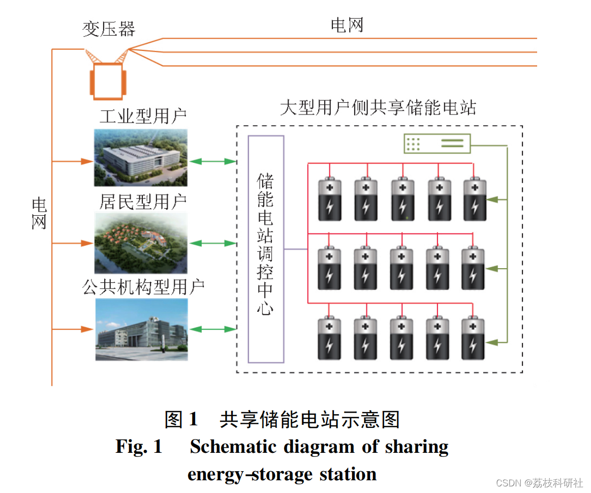
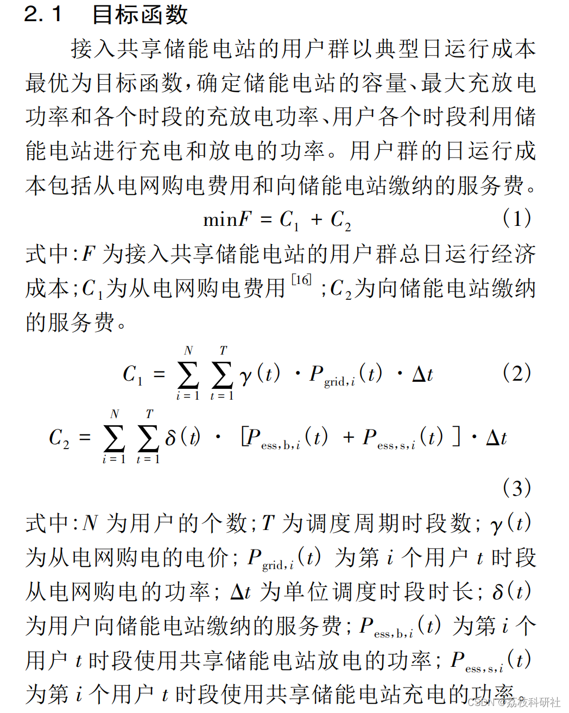
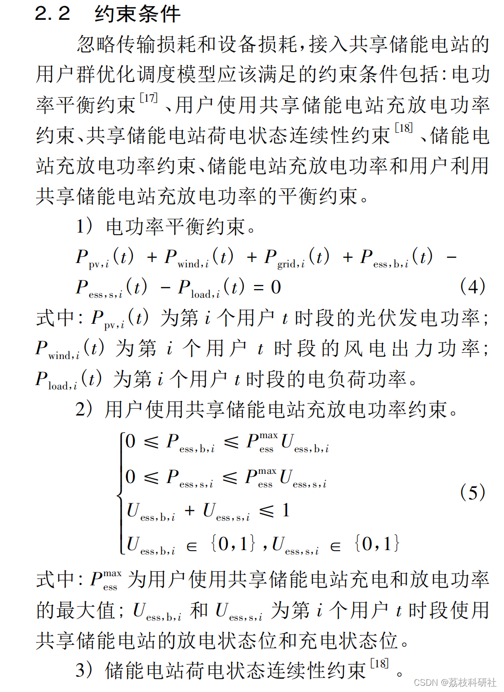
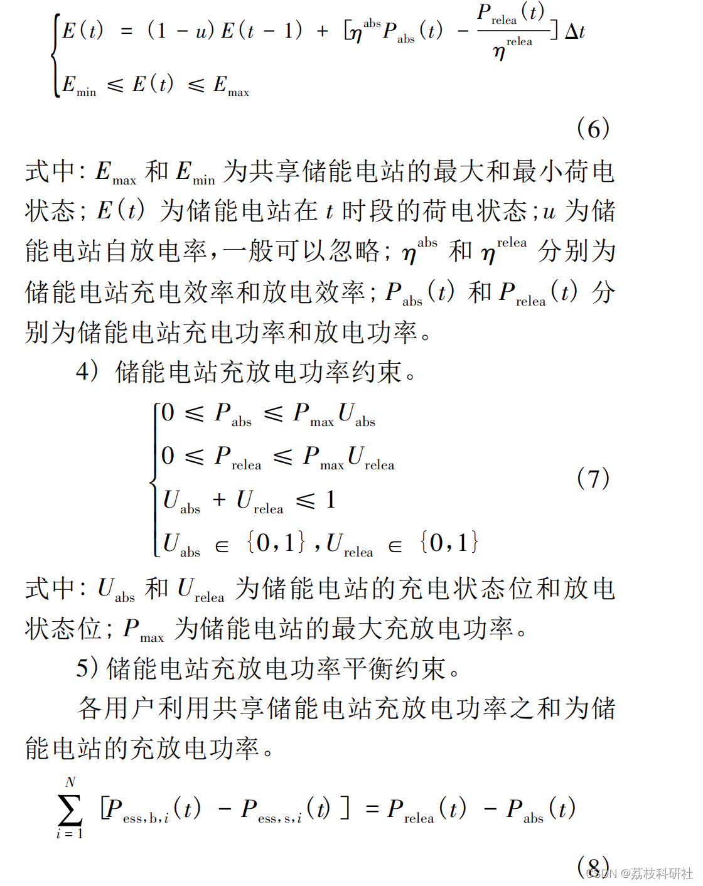
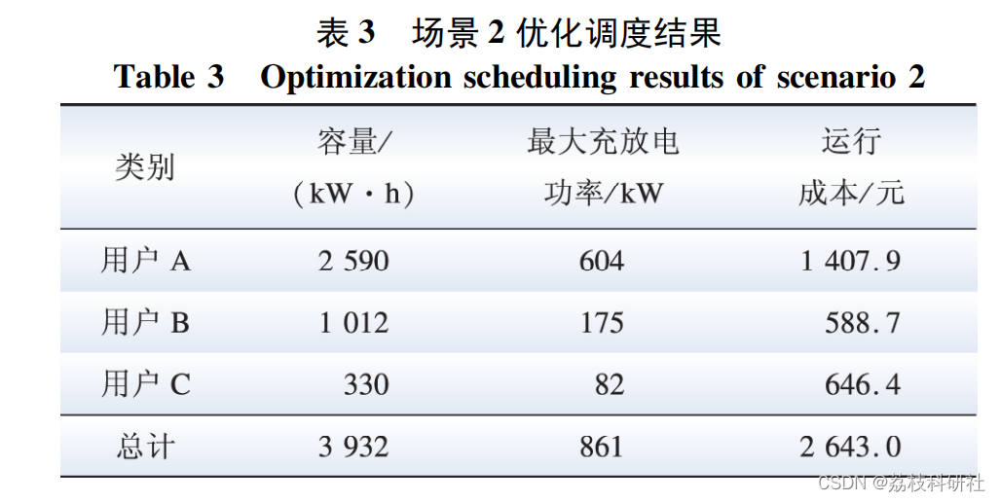
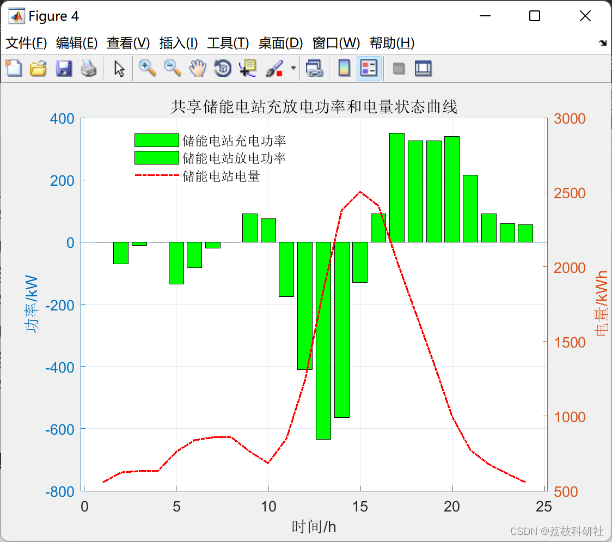
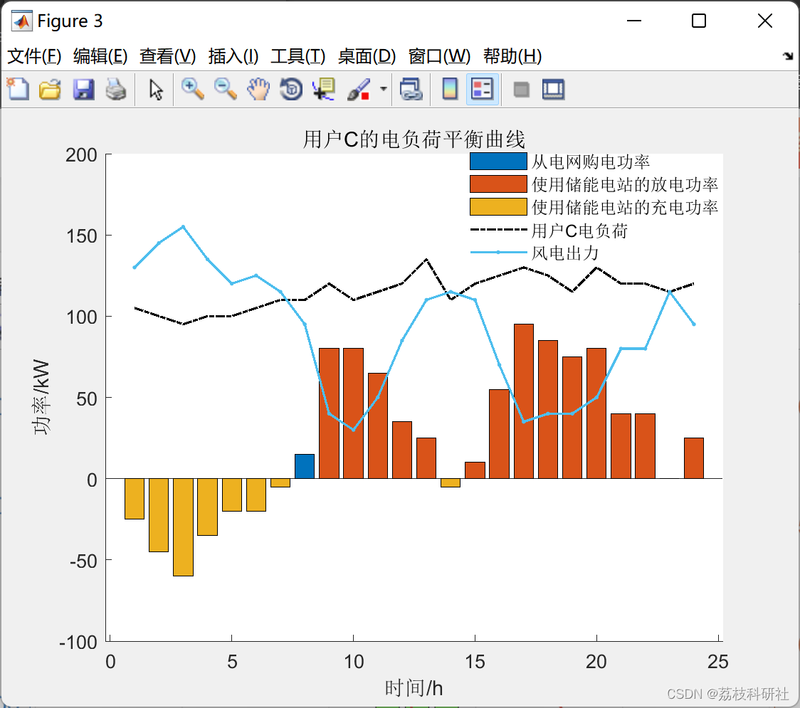
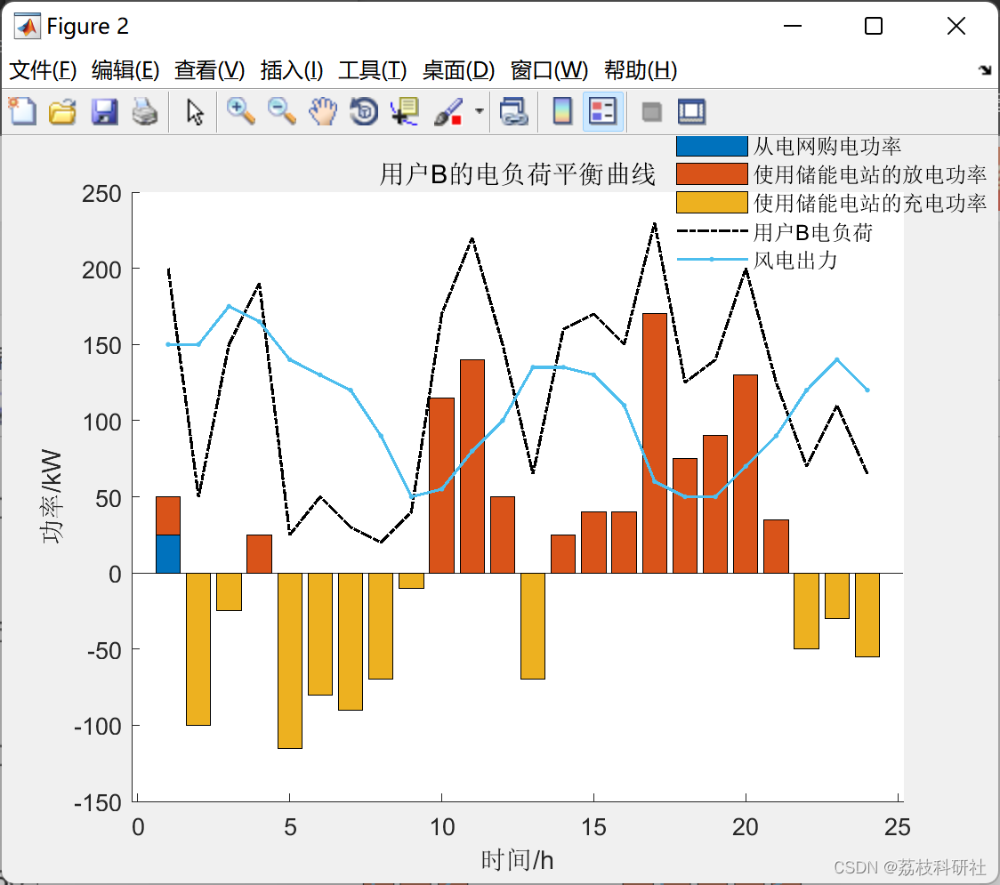
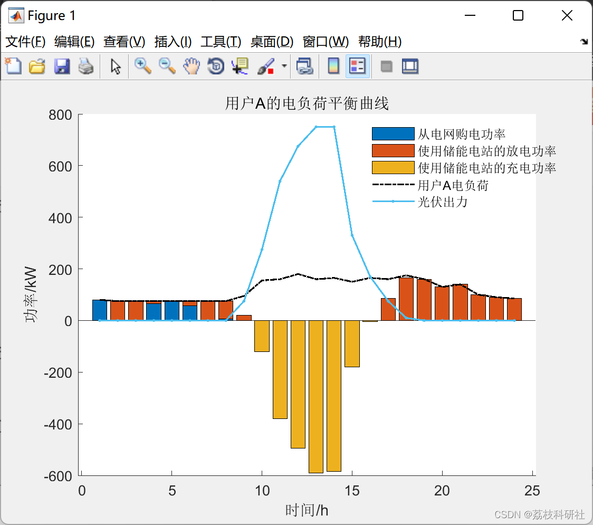

# Economic scheduling optimization for industrial users based on shared energy storage stations (implemented in Matlab)

💥💥💞💞 Welcome to this blog❤️❤️💥💥
🏆 Bloggers' Advantage: 🌞🌞🌞 The content of the blog strives to be rigorous in thought and clear in logic, for the convenience of readers.
⛳️ Mantra: The journey of a hundred miles is half done in the last ninety.
📋📋📋This article is organized as follows: 🎁🎁🎁The directory is💥1 Overview 1.1 Concept and operation model of shared energy storage stations 1.2 Optimized dispatch model based on shared energy storage📚2 Operational results 2.1 Scenario analysis 2.2 Analysis of optimized results for accessing shared energy storage stations🌈4 MATLAB code implementation🎉5 References
​  
Energy storage technology is widely applied in areas such as frequency regulation, peak shaving, stabilizing the fluctuations of renewable energy output, demand-side response, and enhancing user reliability, playing a crucial role in the development of the energy internet. By storing electrical energy in an energy storage system during off-peak electricity prices and releasing it to supply users during peak periods, users can save on electricity costs while alleviating the pressure on grid peak shaving [2,3,4]. The national and local governments are vigorously promoting the application of energy storage technology, with its prospects for development being broad.
Currently, research on shared energy storage is in its infancy. The existing work primarily focuses on the shared energy storage system, analyzing its business model and profitability. There has been no in-depth study into the charging and discharging behaviors of users participating in the shared energy storage system and their economic benefits.
This paper introduces shared energy storage stations among user groups, establishes an optimization dispatch model aimed at the optimal daily operating cost of user groups, analyzes the charging and discharging behaviors and economic benefits of user groups after accessing shared energy storage stations, and further studies the relationship between investment recovery period of shared energy storage stations and service fee pricing.
1.1 Concept and Operation Model of Shared Energy Storage Station
Editor
1.2 Optimal scheduling model based on shared energy storage
Editor
Editor
📚2 Running Results 2.1 Scenario Analysis Edit
1. Product Technical Requirements
CPXPARAM_Simplex_Display            2  
CPXPARAM_MIP_Tolerances_MIPGap         9.9999999999999995e-07  
CPXPARAM_Barrier_Display            2  
Tried aggregator 3 times.  
MIP Presolve eliminated 479 rows and 53 columns.  
Aggregator did 159 substitutions.  
Reduced MIP has 373 rows, 229 columns, and 1198 nonzeros.  
Reduced MIP has 46 binaries, 0 generals, 0 SOSs, and 0 indicators.  
Presolve time = 0.02 sec. (1.67 ticks)  
Found incumbent of value 4919.153611 after 0.03 sec. (2.56 ticks)  
Probing fixed 0 vars, tightened 46 bounds.  
Probing time = 0.00 sec. (0.05 ticks)  
Tried aggregator 1 time.  
MIP Presolve eliminated 256 rows and 147 columns.  
MIP Presolve modified 64 coefficients.  
Reduced MIP has 117 rows, 82 columns, and 396 nonzeros.  
Reduced MIP has 17 binaries, 0 generals, 0 SOSs, and 0 indicators.  
Presolve time = 0.00 sec. (0.31 ticks)  
Probing time = 0.00 sec. (0.01 ticks)  
Tried aggregator 1 time.  
Reduced MIP has 117 rows, 82 columns, and 396 nonzeros.  
Reduced MIP has 17 binaries, 0 generals, 0 SOSs, and 0 indicators.  
Presolve time = 0.02 sec. (0.19 ticks)  
Probing time = 0.00 sec. (0.01 ticks)  
MIP emphasis: balance optimality and feasibility.  
MIP search method: dynamic search.  
Parallel mode: deterministic, using up to 16 threads.  
Root relaxation solution time = 0.00 sec. (0.29 ticks)  
Nodes                Cuts/ 
Node Left  Objective IInf Best Integer Best Bound ItCnt Gap 
*  0+  0    2776.7029 2633.8312 5.15% 
0  0    cutoff 2776.7029         24  0.00% 
Root node processing (before b&c):  
Real time=0.05 sec. (7.26 ticks)  
Parallel b&c, 16 threads:  
Real time=0.00 sec. (0.00 ticks)  
Sync time (average)=0.00 sec.  
Wait time (average)=0.00 sec.  
------------  
Total (root+branch&cut)=0.05 sec. (7.26 ticks)  
UserA Part:  
Optimal energy storage capacity planning value: 2796.5625 kWh  
Optimal energy storage charging and discharging power maximum value: 590 kW  
UserB Part:  
Optimal energy storage capacity planning value: 739.2434 kWh  
Optimal energy storage charging and discharging power maximum value: 130 kW  
UserC Part:
The optimal energy storage capacity planning value is: 698.0099 kWh
The maximum power of optimal energy storage charging and discharging is: 80 kW
>>  
2.2 Analysis of Optimization Results for Accessing Shared Energy Storage Stations
Editor
Editor
Editor
Aggregator did 91 substitutions.  
Reduced MIP has 259 rows, 277 columns, and 858 nonzeros.  
Reduced MIP has 69 binaries, 0 generals, 0 SOSs, and 0 indicators.  
Presolve time = 0.02 sec. (1.05 ticks)  
Probing fixed 9 vars, tightened 111 bounds.  
Probing time = 0.00 sec. (0.09 ticks)  
Cover probing fixed 1 vars, tightened 28 bounds.  
Tried aggregator 2 times.  
MIP Presolve eliminated 81 rows and 66 columns.  
MIP Presolve modified 132 coefficients.  
Aggregator did 6 substitutions.  
Reduced MIP has 172 rows, 205 columns, and 568 nonzeros.  
Reduced MIP has 59 binaries, 0 generals, 0 SOSs, and 0 indicators.  
Presolve time = 0.00 sec. (0.42 ticks)  
Probing fixed 0 vars, tightened 9 bounds.  
Probing time = 0.00 sec. (0.04 ticks)  
Tried aggregator 1 time.  
MIP Presolve eliminated 1 rows and 0 columns.  
MIP Presolve modified 9 coefficients.  
Reduced MIP has 171 rows, 205 columns, and 565 nonzeros.  
Reduced MIP has 59 binaries, 0 generals, 0 SOSs, and 0 indicators.  
Presolve time = 0.00 sec. (0.33 ticks)  
Probing time = 0.00 sec. (0.04 ticks)  
Clique table members: 7.  
MIP emphasis: balance optimality and feasibility.  
MIP search method: dynamic search.  
Parallel mode: deterministic, using up to 16 threads.  
Root relaxation solution time = 0.00 sec. (0.43 ticks)  
Nodes                    Cuts/  
Node Left  Objective IInf Best Integer  Best Bound  ItCnt  Gap  
*  0  0   integral  0  2202.4575  2202.4575   20  0.00%  
Elapsed time = 0.02 sec. (4.91 ticks, tree = 0.00 MB, solutions = 1)  
Root node processing (before b&c):  
Real time      =  0.02 sec. (4.93 ticks)  
Parallel b&c, 16 threads:  
Real time      =  0.00 sec. (0.00 ticks)  
Sync time (average) =  0.00 sec.  
Wait time (average) =  0.00 sec.  
------------  
Total (root+branch&cut) =  0.02 sec. (4.93 ticks)  
🌈3 Matlab code implementation
🎉4 References

## Images

<!-- PAYMENT_BLOCK -->

## Get this dataset

- Payment link (Stripe): [Buy now](https://buy.stripe.com/3cs8yP7sY87d0vu9AB)
- Payment QR code: 

<!-- /PAYMENT_BLOCK -->
